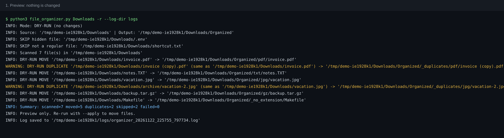
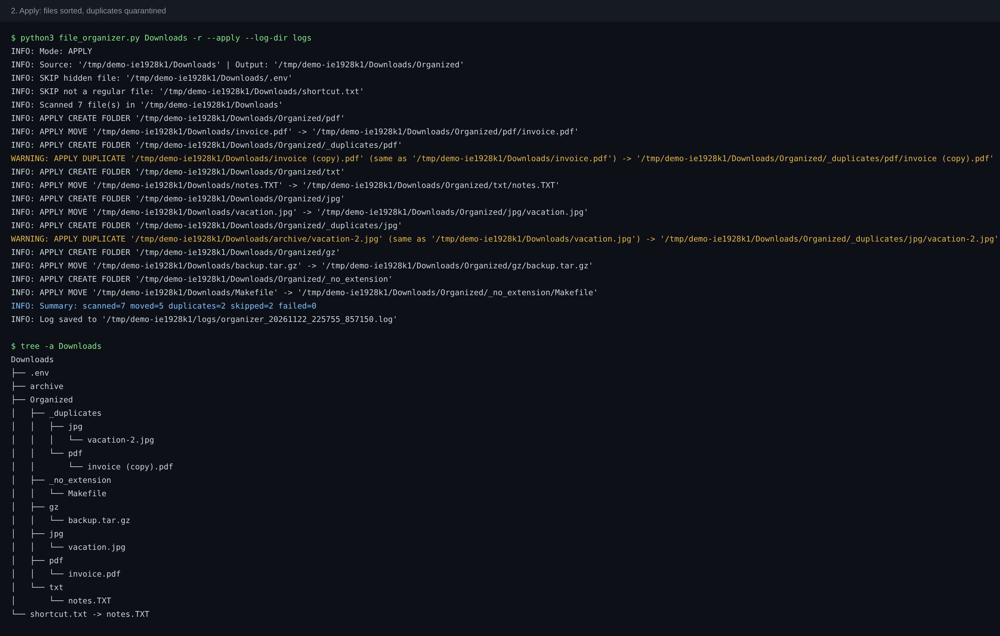
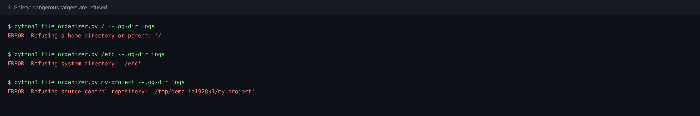

# Automated File Organizer

A safe command-line tool that sorts a messy folder by file extension, finds exact duplicates, and logs every action. It uses only the Python standard library.

It previews by default, and it never deletes or overwrites your files.

## What it does

- **Sorts files by extension**, for example `report.PDF` to `Organized/pdf/report.PDF`.
- **Creates folders automatically**, only when a file needs them.
- **Detects duplicates** by comparing SHA-256 hashes, including against files organized in earlier runs. The oldest copy is kept in place and the others move to `Organized/_duplicates/` for review.
- **Logs everything** to the console and to a private, timestamped log file.

## Demo

These screenshots are real program output from `docs/generate_demo.py`, which runs on sample files in a temporary folder.

**1. Preview what would happen. Nothing changes.**



**2. Apply the changes.**



**3. Dangerous targets are refused.**



## Quick start

You need Python 3.11 or newer on Linux. There is nothing to install.

Preview first:

```bash
python3 file_organizer.py ~/Downloads
```

Move the files once the preview looks right:

```bash
python3 file_organizer.py ~/Downloads --apply
```

| Option | Purpose |
| --- | --- |
| `--apply` | Move files. Without it, the run is only a preview. |
| `-r`, `--recursive` | Include subfolders. |
| `-o`, `--output DIR` | Choose the destination. The default is `SOURCE/Organized`. |
| `--include-hidden` | Include dotfiles and dot folders. |
| `--log-dir DIR` | Choose where logs go. The default is `logs/` beside the script. |

Exit codes are `0` for success, `1` if some files failed, `2` for invalid or unsafe paths, and `130` if interrupted.

## Safety features

- Moves cannot overwrite: the destination is claimed atomically, and name clashes become `name (1).ext`.
- Moves between drives are copied, hash-verified, and only then removed from the source.
- Files that change after scanning are skipped.
- Symlinks, pipes, and devices are never followed or moved.
- System folders, home directories, hidden config folders such as `~/.ssh`, and Git, Mercurial, or Subversion repositories are protected.
- File names are escaped in logs, so a crafted name cannot forge log entries or inject terminal codes.
- Log files are readable only by your user.

## Technologies used

| Technology | Used for |
| --- | --- |
| Python 3.13 (3.11+ supported) | Application language |
| Standard library: `pathlib`, `os`, `shutil`, `hashlib`, `logging`, `argparse`, `dataclasses` | File handling, hashing, logging, and the CLI |
| `unittest` | Automated test suite |
| Coverage.py | Test coverage |
| Ruff | Linting |
| mypy (strict mode) | Static type checking |
| Bandit | Security scanning |
| Chromium (headless) | Rendering demo screenshots |
| Git | Version control |

## Testing

```bash
python3 -m unittest -v
```

The suite has 40 tests and 87% branch coverage. It covers sorting, duplicates, the command line, hostile file names, simulated race conditions, and a randomized check that all file contents survive a run. A real move between two filesystems was also verified by hand.

## Problems encountered and solved

| Problem | Risk | Solution |
| --- | --- | --- |
| Rollback could delete the destination after the source vanished mid-move | Loss of the only copy | Roll back only while the source still exists |
| A symlink inside the output folder could redirect moves | Files written outside the target | Refuse symlinks in the destination path |
| Temporary copies used default permissions | Private files briefly readable by other users | Create copies as `0600`, then restore the original mode |
| Copies could keep setuid or setgid bits | Privilege escalation when run as root | Strip those bits from copies |
| Newlines in file names reached log messages | Forged log entries | Escape paths in every error message |
| Log files were readable by other users | Exposed file names and folder structure | Create logs as `0600` |
| Recursive runs could reorganize Git repositories | Broken projects | Refuse repositories and skip nested ones |
| Folders such as `~/.ssh` were accepted | Broken SSH keys and app settings | Refuse hidden folders in home |
| Using the source as the log folder could move the active log | Lost audit trail | Reject that configuration |
| Name clashes on 255-byte file names failed | Files left unsorted | Trim whole characters to fit the limit |
| Non-UTF-8 consoles caused logging errors | Noisy, unreliable output | Escape unsupported characters |
| Piping into `head` produced thousands of error lines | Unusable output | Stop console output quietly and keep the file log |
| pytest was not installed | Tests could not run | Use the built-in `unittest` and stay dependency-free |

## Known limitations

- Tested on Linux only. macOS may work, and Windows is not supported.
- Emptied subfolders are left in place, because the tool never deletes anything.
- Files are grouped by their last extension, so `backup.tar.gz` goes to `gz/`.
- A copy moved between drives by a different user may not keep the original owner.
